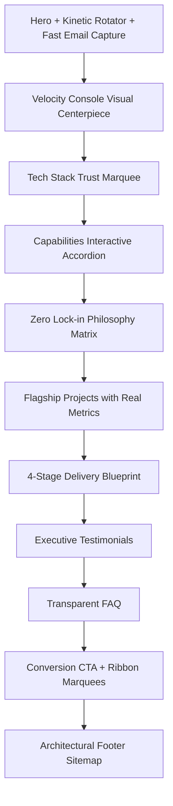

# RiTiVerse — Senior UI/UX Architectural Audit & Engineering Report
**Auditor:** Principal UI/UX Systems Architect & Frontend Engineer (10+ YOE)  
**Date:** October 9, 2026  
**Project:** [RiTiVerse](file:///Users/apple/Desktop/Dhrumil/RiTIVerse-FInal)  
**Scope:** Whole Website (`index.html`, `services.html`, `projects.html`, `about.html`, `contact.html`, and CSS/JS modular architecture)

---

## 1. Executive Summary & Holistic Assessment

RiTiVerse presents a **high-caliber, modern engineering studio aesthetic** inspired by cutting-edge European design studios and architectural platforms (Linear, Stripe, Apple Developer, Framer). The brand narrative—**100% client code ownership, zero vendor lock-in, and sub-second performance**—is compelling, technically authoritative, and addresses the real-world frustration enterprise clients have with traditional agency retainers.

### Overall Scorecard

| Assessment Dimension | Score (/10) | Status | Key Observation |
| :--- | :---: | :---: | :--- |
| **Visual Design & Aesthetics** | **8.8 / 10** | Strong | High-end glassmorphism, dynamic gradients, 3D particle silk canvas, polished card surfaces. |
| **Theme & Color Consistency** | **7.5 / 10** | Needs Attention | Core palette is well-defined, but arbitrary colors (pink, green, amber) bleed into [projects.html](file:///Users/apple/Desktop/Dhrumil/RiTIVerse-FInal/projects.html). |
| **Text & Copywriting** | **8.2 / 10** | Good | High-impact positioning; a few sections slip into generic agency clichés or mismatched footer labels. |
| **Placement & Layout (IA)** | **8.0 / 10** | Good | Excellent sequential storytelling on Home; desktop-only hamburger navigation adds friction. |
| **Accessibility & Usability** | **6.8 / 10** | Action Required | Critical white-on-white text bug on [contact.html](file:///Users/apple/Desktop/Dhrumil/RiTIVerse-FInal/contact.html#L310), disconnected JS event listeners, low-contrast status colors. |
| **Micro-Interactions & Motion**| **9.0 / 10** | Exceptional | GSAP-powered reveals, kinetic rotating text, laser-scanned process cards, smooth accordion transitions. |

---

## 2. Design Audit (Visual Aesthetics, Palette & Styling)

### 2.1 Brand Identity & Color Theme Adherence
The design system established in [base.css](file:///Users/apple/Desktop/Dhrumil/RiTIVerse-FInal/css/base.css#L12-L121) extracts its core palette directly from `assets/logo.png`:
- **Flame Orange (`#F86800`):** Primary dynamic accent.
- **Azure Sky Blue (`#008CD8`):** Secondary engineering accent.
- **Ruby Fire Red (`#C80000`):** Brand tertiary highlight.
- **Surface Canvas (`#F0F9FF` & `#FFFFFF`):** Clean, airy, sky-tinted architectural surfaces.
- **Slate Neutrals (`#0F172A`, `#475569`, `#64748B`):** High-readability typography.

#### Strengths:
1. **Curated Glassmorphic System:** The use of subtle borders (`rgba(0, 140, 216, 0.18)`), backdrop filters (`blur(16px)`), and layered box shadows creates depth without visual noise.
2. **Hero Motion & Kinetic Typography:** The silk-dust particle canvas and 3D kinetic text rotator (`You Own It. Zero Lock-In.`) create an immediate emotional impact on first load.
3. **Custom Graphic Accents:** Cohesive cross-grid marks, laser-scanner lines, and subtle glow effects anchor the high-tech identity.

#### Deficiencies & Inconsistencies:
1. **Rogue Colors in Project Icons:** In [projects.html](file:///Users/apple/Desktop/Dhrumil/RiTIVerse-FInal/projects.html#L274-L408), the card hero SVGs introduce arbitrary accent colors not calibrated to the brand design system:
   - OmniSphere: `#34D399` (Mint Green)
   - Pulse Luxury: `#F59E0B` (Amber)
   - Apex Dashboard: `#818CF8` (Indigo)
   - Strata Gateway: `#EC4899` (Hot Pink)
   *Recommendation:* Re-anchor all card icons strictly to the brand token scale: `--brand-blue`, `--brand-orange`, `--brand-red`, and `--accent-slate`.
2. **Critical Contrast Failure in Contact Page:** In [contact.css](file:///Users/apple/Desktop/Dhrumil/RiTIVerse-FInal/css/contact.css#L141-L149), `.faq-question` is explicitly styled with:
   ```css
   .faq-question {
     color: #FFFFFF; /* Invisible on white card surface rgba(255, 255, 255, 0.88) */
   }
   ```
   This renders the FAQ questions on [contact.html](file:///Users/apple/Desktop/Dhrumil/RiTIVerse-FInal/contact.html) completely invisible to users.
3. **Visual Disparity Between Showcase and Portfolio:** 
   - [index.html](file:///Users/apple/Desktop/Dhrumil/RiTIVerse-FInal/index.html#L1066-L1115) displays rich, high-resolution project cards (`assets/card_software_apis.jpg`, `assets/card_cloud_devops.jpg`).
   - [projects.html](file:///Users/apple/Desktop/Dhrumil/RiTIVerse-FInal/projects.html#L180-L445) downgrades these flagships to generic 200px boxes containing flat SVG line drawings. This undermines the premium claim of "Battle-Tested Software".

---

## 3. Text & Copywriting Audit (Voice, Hierarchy & Clarity)

### 3.1 Voice & Positioning
The core brand positioning is extraordinarily sharp:
> *"Software Without Compromise. Technology Without Vendor Lock-In."*
> *"Custom-built websites and software with full source ownership, so your technology never depends on us."*

This positions RiTiVerse far above generic "full-service digital agencies" as a serious, senior software engineering partner.

### 3.2 Typographic Hierarchy
The three-font typographic stack is well-chosen:
1. **Display:** `'Outfit'` — geometric, contemporary, confident headers.
2. **Body:** `'Plus Jakarta Sans'` — clean, highly legible body copy at 14px–16px.
3. **Monospace:** `'JetBrains Mono'` — architectural badges, telemetry labels, and code snippets.

### 3.3 Copywriting Inconsistencies & Friction Points

1. **Voice Regression in Services Page:**
   In [services.html](file:///Users/apple/Desktop/Dhrumil/RiTIVerse-FInal/services.html#L196-L199):
   > *"We offer services that can help businesses improve their visibility and business reputation online, expand market reach, and increase turnover through effective digital strategies. Following are the services we provide:"*
   
   *Critique:* The phrase *"improve their visibility and business reputation online... Following are the services we provide:"* reads like generic $500/mo SEO marketing agency boilerplate. It directly clashes with the technical rigor established everywhere else.  
   *Refined Alternative:*  
   > *"We architect mission-critical digital systems engineered to scale operations, eliminate latency, and maximize enterprise throughput. Explore our specialized engineering domains below:"*

2. **Footer Sitemap Discrepancy Across Pages:**
   In the footer of [index.html](file:///Users/apple/Desktop/Dhrumil/RiTIVerse-FInal/index.html#L1729), [about.html](file:///Users/apple/Desktop/Dhrumil/RiTIVerse-FInal/about.html#L377), and [projects.html](file:///Users/apple/Desktop/Dhrumil/RiTIVerse-FInal/projects.html#L494), Column 3 lists:
   - *Aegis Financial OS*
   - *Verve Logistics Engine*
   - *PulseHealth Clinical AI* ⚠️
   
   However, on [projects.html](file:///Users/apple/Desktop/Dhrumil/RiTIVerse-FInal/projects.html), the case study is named **OmniSphere Private AI Workspace**, not *PulseHealth Clinical AI*. This creates cognitive friction when navigating.

3. **Status Feedback Contrast in Contact Form:**
   In [contact.js](file:///Users/apple/Desktop/Dhrumil/RiTIVerse-FInal/js/contact.js#L63):
   ```javascript
   status.style.color = '#34D399'; // Very light mint green on light background
   ```
   This fails WCAG 2.1 AA text contrast requirements against the light surface. It should use `#059669` or `#065F46`.

---

## 4. Placement & Layout Audit (Information Architecture & Flow)

### 4.1 Navigation & Header Architecture
- **Desktop Nav Pattern:** On screens >1024px, the header is stripped down to just the logo and a 3-line hamburger menu trigger.
  - *UI/UX Critique:* While this offers a hyper-minimal look, forcing a full-screen modal open for every single page transition increases user interaction cost by 200%. High-intent B2B visitors (CTOs, Product Heads) expect quick access to **Services**, **Projects**, and a prominent **"Start Project"** button.
  - *Recommendation:* Implement a **hybrid floating navbar capsule** on desktop (showing `Services`, `Projects`, `About`, `Contact` + `Start Project` CTA button) while retaining the hamburger trigger for detailed exploration or mobile viewports.

- **Fullscreen Menu Spatial Structure:**
  In [index.html](file:///Users/apple/Desktop/Dhrumil/RiTIVerse-FInal/index.html#L88-L128):
  - **Column 1:** Home, Services, Contact
  - **Column 2:** About, Projects
  
  *UX Hierarchy Problem:* Placing `Contact` in Column 1 above `About` and `Projects` violates natural mental models. A prospective client explores: `Services` → `Projects` (Proof) → `About` (Team/Philosophy) → `Contact` (Conversion).
  - *Better Grid Grouping:*
    - **Column 1 (Core Work):** Home, Services, Projects
    - **Column 2 (Company):** About Us, Philosophy, Contact Us

- **Missing Active State on Home Page:**
  In [index.html](file:///Users/apple/Desktop/Dhrumil/RiTIVerse-FInal/index.html#L91), the Home navigation link is missing `class="active"`, whereas all other pages correctly highlight their respective page.

### 4.2 Homepage Page Flow & Narrative Sequence



#### Evaluation of Page Flow:
- **Hero-to-Console Transition:** The Apple-style clean reveal anchoring into the `.synex-dashboard-window` is visually commanding and demonstrates engineering credibility immediately.
- **Philosophy Matrix Placement:** Placing the side-by-side comparison matrix right after capabilities is brilliant: it directly addresses the buyer's skepticism before showing case studies.
- **Hero Form Interaction:** The hero input (`#hero-email-input`) captures email, but on submit, it simply displays a message and clears the input after 2 seconds. It does not carry forward the user's intent to [contact.html](file:///Users/apple/Desktop/Dhrumil/RiTIVerse-FInal/contact.html).
  *UX Recommendation:* Redirect or prefill the captured email into [contact.html?email=alex@company.com](file:///Users/apple/Desktop/Dhrumil/RiTIVerse-FInal/contact.html) so the user seamlessly completes project details.

### 4.3 Projects Page ([projects.html](file:///Users/apple/Desktop/Dhrumil/RiTIVerse-FInal/projects.html))
1. **Interactive Filter Pills:** The category filter bar (`All`, `Web`, `Custom`, `Cloud`, `AI`) operates smoothly via [projects.js](file:///Users/apple/Desktop/Dhrumil/RiTIVerse-FInal/js/projects.js).
2. **Missing Action Trigger / Dead Ends:** The cards display metrics and tech tags, but there is no call-to-action button, no modal preview, and no external link. When a visitor clicks on a card, nothing happens.
   *UX Recommendation:* Add an interactive "Explore Architecture ↗" drawer or modal showcasing system diagrams, architecture breakdown, and client deliverables.

### 4.4 Contact Page ([contact.html](file:///Users/apple/Desktop/Dhrumil/RiTIVerse-FInal/contact.html))
1. **Layout Balance:** The two-column split (1.15fr Form : 0.85fr Direct Coordinates + Guarantees) is balanced and provides immediate reassurance.
2. **JavaScript Selector Mismatch:**
   In [contact.js](file:///Users/apple/Desktop/Dhrumil/RiTIVerse-FInal/js/contact.js#L15):
   ```javascript
   const trigger = item.querySelector('.faq-question-btn');
   ```
   In [contact.html](file:///Users/apple/Desktop/Dhrumil/RiTIVerse-FInal/contact.html#L310), the markup is `<div class="faq-question">`, not `<button class="faq-question-btn">`. As a result, the accordion script silently fails to attach, leaving FAQ items permanently static.
3. **Form Validation & Ergonomics:**
   Fields are properly grouped (Dual rows for Name/Email and Company/Scope). The "Guaranteed 24-Hour Response SLA" pill is strong psychological reassurance.

---

## 5. Technical Accessibility (WCAG 2.1 AA) & Performance Audit

| Issue Code | Element / Page | Severity | Description | Fix Requirement |
| :--- | :--- | :---: | :--- | :--- |
| **A11Y-01** | `.faq-question` in [contact.css](file:///Users/apple/Desktop/Dhrumil/RiTIVerse-FInal/css/contact.css#L144) | **CRITICAL** | White text (`#FFFFFF`) on white container (`#FFFFFF`). Contrast ratio 1:1. | Change color to `var(--text-primary-dark)` (`#0F172A`). |
| **A11Y-02** | `.faq-question` in [contact.html](file:///Users/apple/Desktop/Dhrumil/RiTIVerse-FInal/contact.html#L310) | **HIGH** | Uses non-interactive `<div>` for collapsible question instead of semantic `<button>`. Screen readers cannot trigger it. | Refactor to `<button class="faq-question-btn" type="button" aria-expanded="false">`. |
| **A11Y-03** | Status message in [contact.js](file:///Users/apple/Desktop/Dhrumil/RiTIVerse-FInal/js/contact.js#L63) | **MEDIUM** | `#34D399` text color on light background fails WCAG 4.5:1 ratio. | Use `#065F46` or `#059669`. |
| **A11Y-04** | Form resets in [index.js](file:///Users/apple/Desktop/Dhrumil/RiTIVerse-FInal/js/index.js#L365) | **LOW** | `btn.style.backgroundColor = ''` does not clear `btn.style.background`, leaving lingering gradient styles. | Reset `btn.style.background = ''`. |
| **A11Y-05** | Case study SVGs in [projects.html](file:///Users/apple/Desktop/Dhrumil/RiTIVerse-FInal/projects.html#L408) | **MEDIUM** | Stroke colors violate theme restrictions (`#EC4899`, `#818CF8`). | Unify stroke colors with `--brand-blue` or `--brand-orange`. |

---

## 6. Strategic UX Recommendations & Action Plan

### Priority 0: Critical Fixes (Immediate Execution)
1. **Fix Contact Page FAQ Contrast:**
   In [contact.css](file:///Users/apple/Desktop/Dhrumil/RiTIVerse-FInal/css/contact.css#L141-L150), change `.faq-question` color from `#FFFFFF` to `#0F172A`, and `.faq-answer` color from `#94A3B8` to `#475569`.
2. **Align Contact Page FAQ Markup with JS:**
   Update [contact.html](file:///Users/apple/Desktop/Dhrumil/RiTIVerse-FInal/contact.html#L308-L341) to use `<button class="faq-question-btn">` matching [contact.js](file:///Users/apple/Desktop/Dhrumil/RiTIVerse-FInal/js/contact.js) and [index.html](file:///Users/apple/Desktop/Dhrumil/RiTIVerse-FInal/index.html).
3. **Harmonize Theme Colors in Projects Page:**
   Replace `#EC4899` (pink), `#818CF8` (indigo), `#F59E0B` (amber), and `#34D399` (mint) in [projects.html](file:///Users/apple/Desktop/Dhrumil/RiTIVerse-FInal/projects.html) with brand tokens (`--brand-blue`, `--brand-orange`, `--brand-red`).
4. **Mark Active Home Link:**
   Add `class="fs-nav-link active"` to `Home` link in [index.html](file:///Users/apple/Desktop/Dhrumil/RiTIVerse-FInal/index.html#L91).

### Priority 1: High-Conversion UX Enhancements
1. **Desktop Floating Navigation Capsule:**
   Introduce direct links (`Services`, `Projects`, `About`, `Contact`) in the top floating navbar on desktop viewports so users can browse without having to open the fullscreen overlay every time.
2. **Elevate Projects Page Imagery:**
   Replace the flat 200px SVG placeholder boxes in [projects.html](file:///Users/apple/Desktop/Dhrumil/RiTIVerse-FInal/projects.html) with actual platform previews (using existing high-res assets like `card_web_apps.jpg`, `card_software_apis.jpg`, `card_cloud_devops.jpg`).
3. **Hero Email Continuity:**
   When visitors submit their work email on [index.html](file:///Users/apple/Desktop/Dhrumil/RiTIVerse-FInal/index.html), pass the value via query string to [contact.html?email=...](file:///Users/apple/Desktop/Dhrumil/RiTIVerse-FInal/contact.html) so their consultation inquiry is immediately pre-filled.
4. **Synchronize Sitemap Labels:**
   Change the footer link in [index.html](file:///Users/apple/Desktop/Dhrumil/RiTIVerse-FInal/index.html), [about.html](file:///Users/apple/Desktop/Dhrumil/RiTIVerse-FInal/about.html), and [projects.html](file:///Users/apple/Desktop/Dhrumil/RiTIVerse-FInal/projects.html) from *PulseHealth Clinical AI* to *OmniSphere AI Workspace*.

### Priority 2: Copywriting & Content Polish
1. **Refine Services Intro:**
   Replace the generic marketing agency text in [services.html](file:///Users/apple/Desktop/Dhrumil/RiTIVerse-FInal/services.html#L196-L199) with sharp, enterprise architectural positioning.
2. **Re-order Fullscreen Menu Columns:**
   Re-sequence menu columns to follow natural discovery: Group `Home`, `Services`, and `Projects` in Column 1; `About` and `Contact` in Column 2.

---
*Report prepared by Senior UI/UX Systems Architect for RiTiVerse.*
